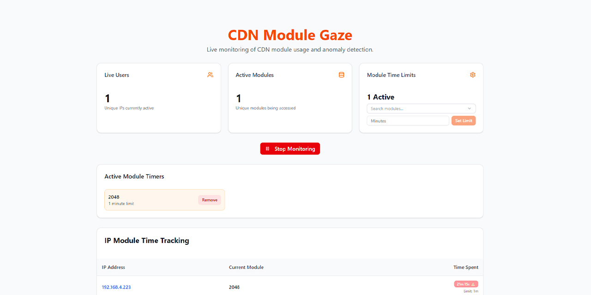

# Module Gaze

Live dashboard for CLC / center admins: see who is viewing which CDN learning modules on an **oc4d** host.

- **Port:** `3002`
- **Runs beside:** `oc4d.service` (same PostgreSQL)
- **Docs:** [`docs/DEVELOPER_WIKI.md`](docs/DEVELOPER_WIKI.md) ← architecture, schema, APIs, deploy

## What you get

- Background tracking from `journalctl -u oc4d.service` (no browser needed on the Pi)
- Optional browser heartbeats for static HTML modules
- Live `(ip, username)` sessions with display names from the shared `User` table
- Module catalog from DB + on-disk uploads scan
- Plain logs under `/var/log/modulegaze` with daily zip archives

```text
oc4d.service ──journalctl──▶ sessions ──▶ UI (:3002)
module pages ──/api/module-heartbeat──┘
```

## Install on the Pi

```bash
ssh pi@cdn.local
git clone https://github.com/ComDevNet/cdn-module-gaze.git
cd cdn-module-gaze
chmod +x install.sh && ./install.sh
```

Then open `http://oc4d.cdn:3002`.

`install.sh` installs Bun, builds the app, installs `cdnmodulegaze.service`, and **restarts** it so new builds/env apply. Ensure `DATABASE_URL` / `DIRECT_URL` are available (usually via `.env` in the app directory).

With `MODULEGAZE_BACKGROUND_MONITOR=1` (default in the unit), sessions are tracked automatically. Use the UI to pause/resume the live view and to set module time limits.

## Production env (already in the unit file)

```bash
MODULEGAZE_BACKGROUND_MONITOR=1
MODULEGAZE_TEE_ACCESS_LOG=1
MODULEGAZE_JOURNAL_SINCE=today
MODULEFETCH_PERIODIC_FLUSH_MINUTES=5
MODULEFETCH_LOG_DIR=/var/log/modulegaze
MODULEGAZE_UPLOADS_MODULES_ROOT=/home/pi/oc4d-server/workspaces/website/uploads/modules
```

Full list and local-dev steps: [Developer Wiki § Env vars](docs/DEVELOPER_WIKI.md#5-env-vars) · [§ Run it](docs/DEVELOPER_WIKI.md#4-run-it-local--production)

## Quick check after deploy

```bash
sudo systemctl status cdnmodulegaze --no-pager
curl -s http://127.0.0.1:3002/api/live-sessions
curl -s http://127.0.0.1:3002/api/modules
sudo ls -lah /var/log/modulegaze
```

## APIs (summary)

| Route | Role |
|-------|------|
| `GET /api/live-sessions` | Live sessions |
| `POST /api/module-heartbeat` | Browser `ping` / `close` |
| `GET /api/logs/stream` | SSE journal feed |
| `GET /api/modules` | Catalog + diagnostics |
| `GET /api/stats` | Counts + flags |
| `GET /api/user-pool` | Email → display name |
| `POST /api/modulefetch/ingest` | Write session log line |
| `POST /api/modulefetch/purge` | Drop archives older than ~1 year |

Details: [Developer Wiki § API contracts](docs/DEVELOPER_WIKI.md#3-api-contracts)

---

**Built with:** Next.js 15, React 19, TypeScript, Bun, Prisma, PostgreSQL, Tailwind CSS, shadcn/ui
